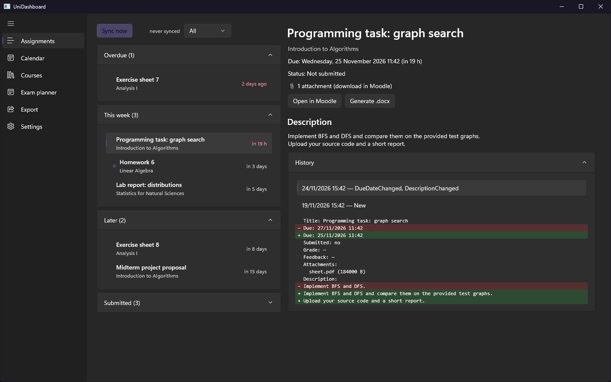
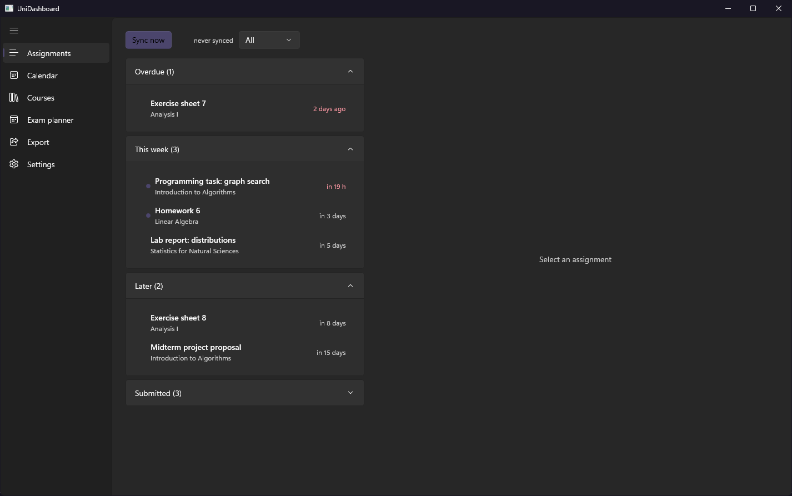
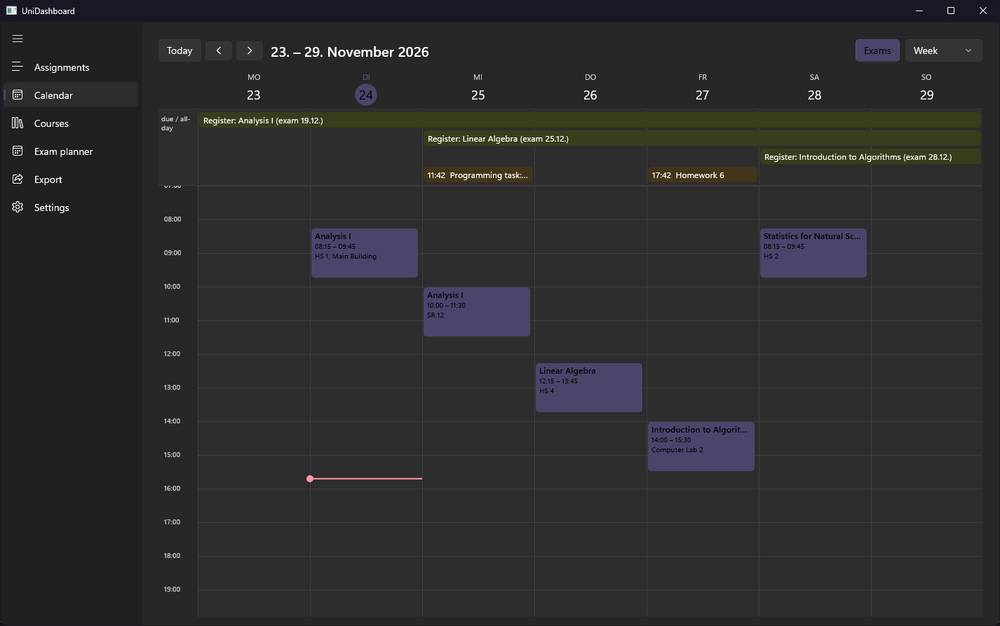
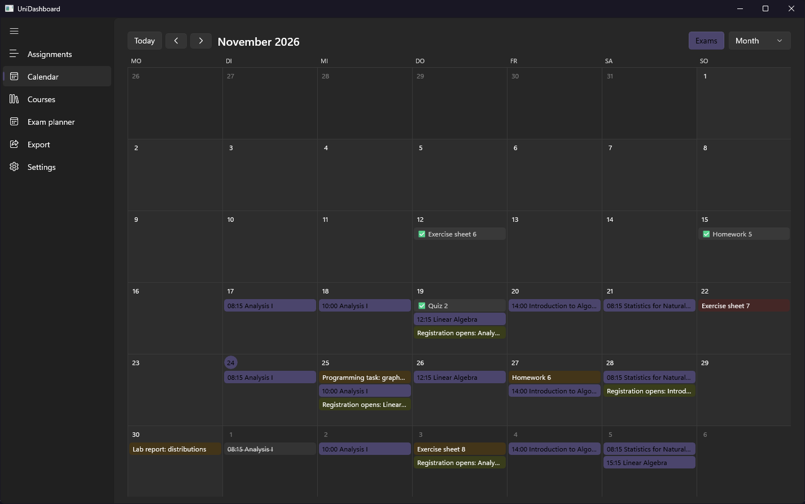
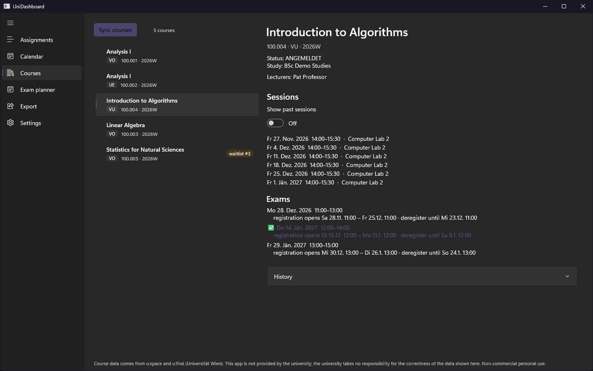
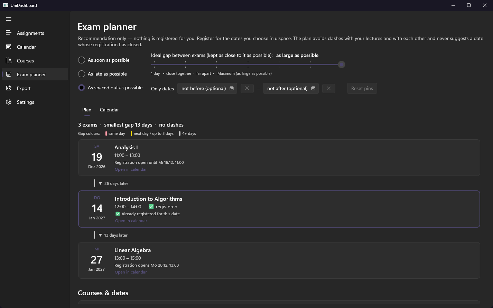
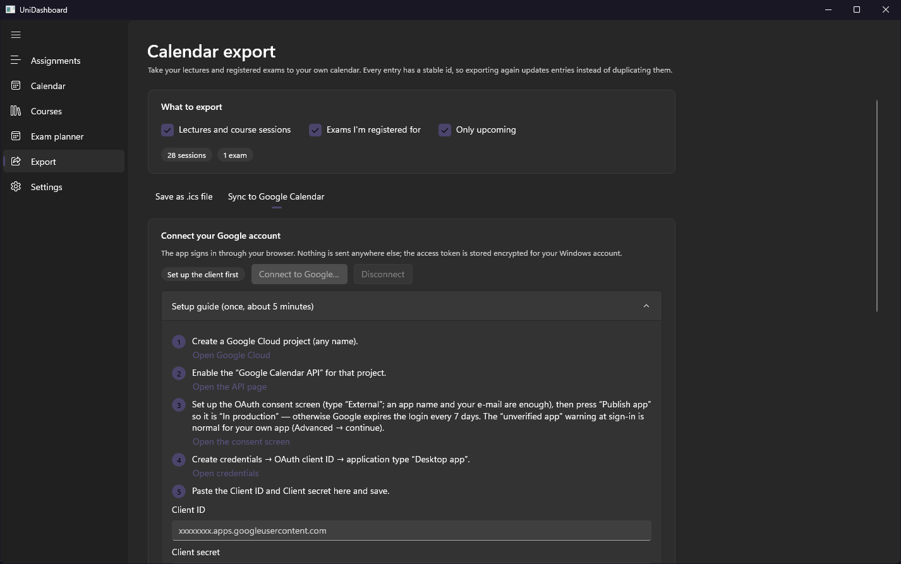
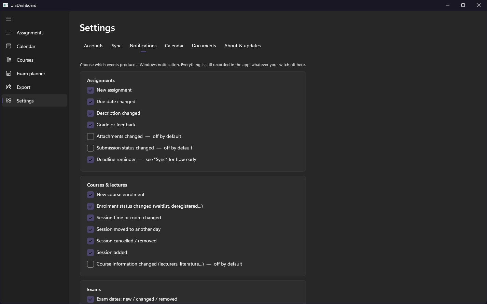
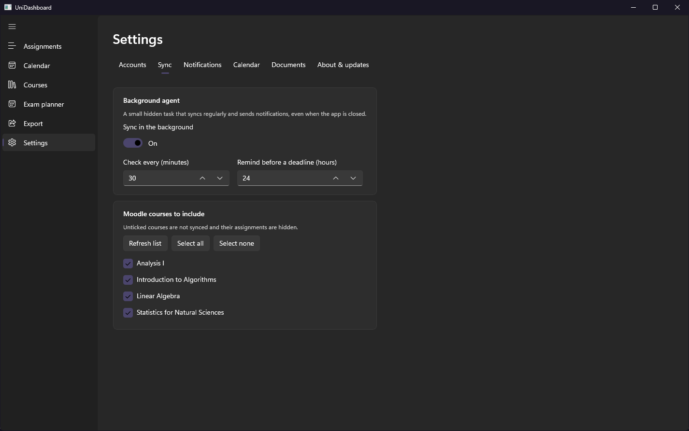

# UniDashboard

**A native Windows dashboard for University of Vienna students.** It pulls your Moodle assignments, your u:space course registrations and your u:find timetables into one fast desktop app. It tells you when something changes, and it can mirror your timetable into Google Calendar or an `.ics` file without ever creating duplicates.



> **Unofficial.** UniDashboard is a personal, non-commercial tool. It is not provided by, affiliated with or endorsed by the Universität Wien, Moodle or Google. Course data comes from u:space and u:find and may be wrong or late; always check the official sources for anything that matters.

## Highlights

| | |
|---|---|
| **Assignments** | Every Moodle assignment, grouped *Overdue / Today / This week / Later / Submitted*, with relative due times, submission status and a link to the Moodle page. |
| **Change history** | Every change to an assignment (due date, description, grade, attachments) is stored as a snapshot and shown as a coloured diff. |
| **Calendar** | Week and month view combining lectures, exams, registration windows and assignment deadlines. Moved sessions show as ghosts at the old time, cancelled ones are struck through. |
| **Courses** | Your u:space enrolments with sessions, rooms, lecturers, waitlist position and all exam dates. |
| **Exam planner** | Suggests an exam date per course (as soon / as late / as spread out as possible) that avoids clashes with lectures and with each other. It only recommends; nothing is registered for you. |
| **Export** | Save an `.ics` file, or sync to a Google Calendar of your choice. Stable event ids mean re-importing updates entries instead of duplicating them. |
| **Notifications** | A hidden background task syncs every N minutes and raises Windows toasts for new assignments, moved sessions, exam registration windows and more. Every kind can be switched off. |
| **Word documents** | One click turns an assignment into a `.docx` (title page with your name and Matrikelnummer) from your own template. |
| **Private by design** | Everything is stored locally. Tokens are encrypted with Windows DPAPI, your password lives in the Windows Credential Manager. |

## Screenshots

<table>
<tr>
<td width="50%"><b>Assignments</b><br></td>
<td width="50%"><b>Calendar (week)</b><br></td>
</tr>
<tr>
<td><b>Calendar (month)</b><br></td>
<td><b>Courses</b><br></td>
</tr>
<tr>
<td><b>Exam planner</b><br></td>
<td><b>Export to Google Calendar / .ics</b><br></td>
</tr>
<tr>
<td><b>Notification settings</b><br></td>
<td><b>Background sync settings</b><br></td>
</tr>
</table>

*All screenshots use fake demo data* (see [Development](#development)).

## Install

### Installer (recommended)

1. Download `UniDashboard-Setup-x.y.z.exe` from the [latest release](https://github.com/TheRealCheeseLord/UniDashboard/releases/latest).
2. Run it. It installs for your user only (no admin rights) and adds a Start Menu entry.
3. **Windows SmartScreen** will say *"Windows protected your PC"* because the installer is not code-signed yet (certificates cost money; free open-source signing is planned). Click **More info → Run anyway**.

Want to be sure the file is the one built by this repository? Compare its checksum with the `.sha256` file next to it on the release page:

```powershell
(Get-FileHash .\UniDashboard-Setup-x.y.z.exe -Algorithm SHA256).Hash
```

Requirements: Windows 10 (1809) or Windows 11, x64, and Google Chrome or Microsoft Edge (for the university single sign-on; Chrome is tried first).

### Updates

The app checks GitHub for a newer release when it starts (at most once a day) and shows a banner; one click downloads, verifies the checksum, installs and restarts. Nothing is ever installed without your click, and your data stays untouched. Switch the check off, or check manually, under **Settings → About & updates**. You can also simply run a newer installer over the old one.

### Uninstall

*Settings → Apps → Installed apps → UniDashboard*. It stops the background task and asks whether to delete your data (database, saved logins, logs). Choose *No* to keep it for a later reinstall.

### Build from source

You need the [.NET 10 SDK](https://dotnet.microsoft.com/download/dotnet/10.0) and Git.

```powershell
git clone https://github.com/TheRealCheeseLord/UniDashboard.git
cd UniDashboard
.\publish.ps1
```

`publish.ps1` builds the app and the background agent (self-contained, win-x64) into `%LOCALAPPDATA%\UniDashboard\bin`, the same place the installer uses. It stops a running copy first, so you can run it again at any time to update. To build the installer yourself see [docs/releasing.md](docs/releasing.md).
## First run

1. Open **Settings → Accounts**, enter your Moodle address and press **Log in**. Your browser opens for the university login; the app keeps the session.
2. Optionally save your u:account username and password under *University login* so the background agent can log in silently (stored in the Windows Credential Manager).
3. Open **Settings → Sync**, pick the Moodle courses to include and switch on **Sync in the background**.
4. Press **Sync now** on the Assignments page, and **Sync courses** on the Courses page.

More detail in [docs/getting-started.md](docs/getting-started.md).

## Documentation

- [Getting started](docs/getting-started.md): setup, login, background agent, troubleshooting
- [Features](docs/features.md): what every page does
- [Google Calendar setup](docs/google-calendar-setup.md): one-time OAuth client setup and the sync safety rules
- [Architecture](docs/architecture.md): projects, data flow, storage, security
- [Releasing](docs/releasing.md): how installers and updates are built and published
- [Original design notes](docs/design-notes.md): the first (Moodle-only) spec, kept for history

## Privacy and security

- All data stays on your machine in `%LOCALAPPDATA%\UniDashboard` (SQLite database, logs). The app talks only to Moodle, u:space, u:find and, if you enable it, Google Calendar.
- Moodle token and Google credentials are encrypted with DPAPI for your Windows account (`token.bin`, `google.bin`).
- Your u:account password is kept in the Windows Credential Manager, never in the database.
- The Google integration asks only for permission to manage calendar events and to list your calendars, and it only ever changes events that carry its own hidden tag.

## Development

```powershell
dotnet build UniDashboard.slnx
dotnet test UniDashboard.Core.Tests          # 180+ unit tests, no network needed
```

| Project | What it is |
|---|---|
| `UniDashboard.Core` | All logic: Moodle/u:space/u:find clients, change detection, storage, export, Google sync, exam planner |
| `UniDashboard.App` | The WinUI 3 desktop app |
| `UniDashboard.Agent` | Headless console app run by Task Scheduler: one sync pass, toasts, exit |
| `UniDashboard.Core.Tests` | xUnit tests (planner safety rules, differs, export, Google client with fakes) |
| `UniDashboard.Smoke` | Developer console tool: login/sync smoke tests and the demo-data seeder |

Setting the environment variable `UNIDASHBOARD_DATA_DIR` makes the app use a different data folder. `docs/capture-screenshots.ps1` uses it together with `UniDashboard.Smoke --seed-demo` to regenerate every screenshot from fake data without touching your real data.

## License

UniDashboard is free software: you can redistribute it and/or modify it under the terms of the **GNU General Public License v3.0 or later**. See [LICENSE](LICENSE). It comes with no warranty.