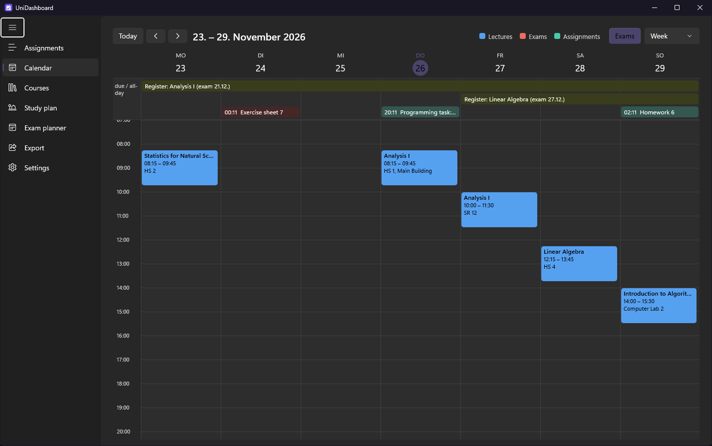
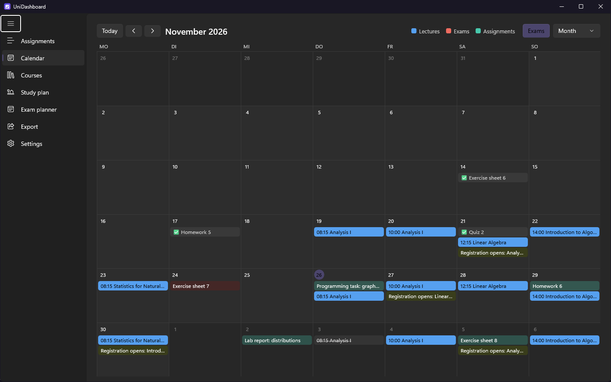
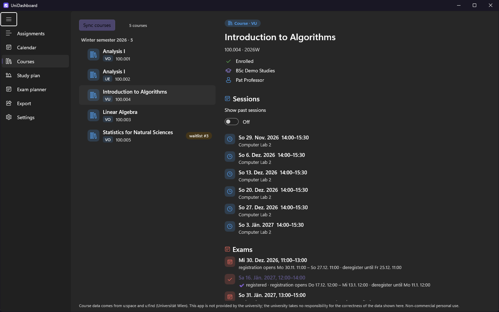
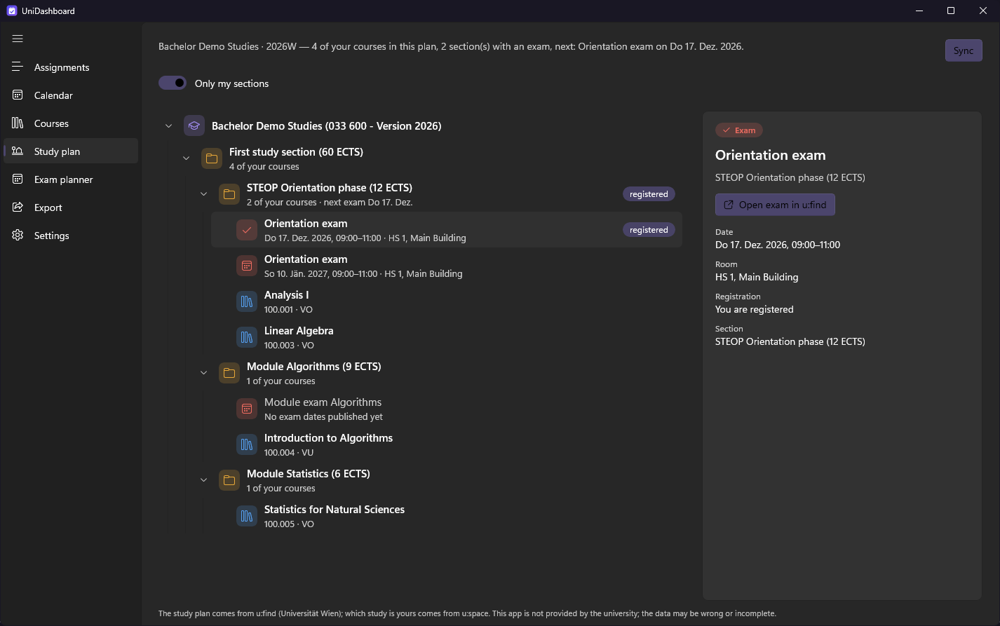
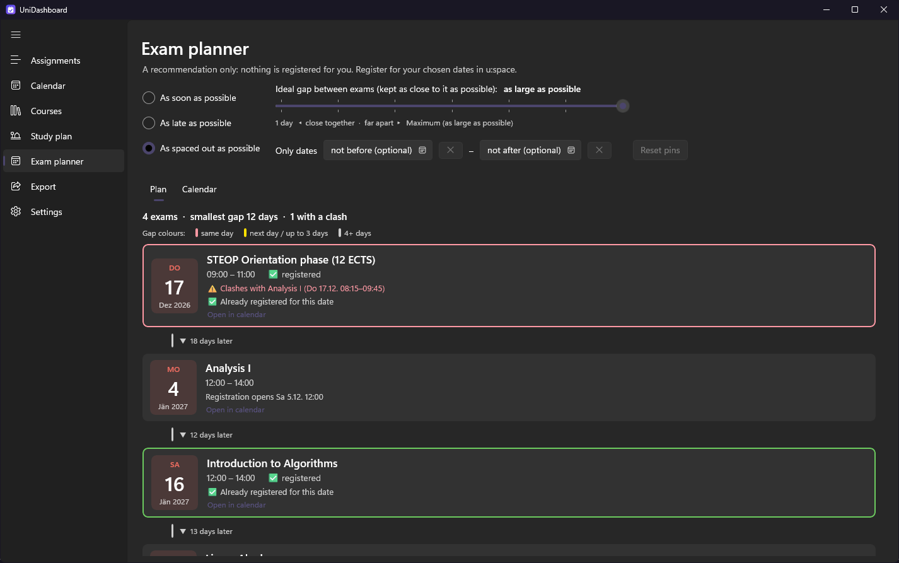
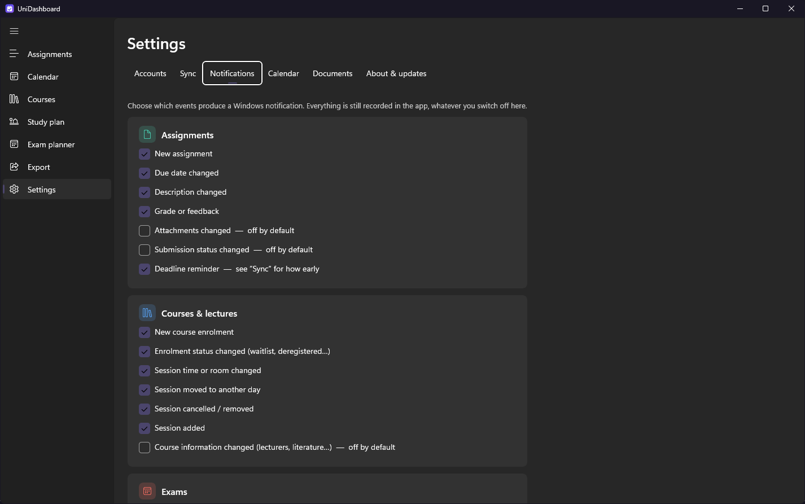

# Features

## Assignments

- **Grouped list**: Overdue (only if not submitted), Today, This week, Later, and Submitted. Overdue and Submitted start collapsed (Submitted is open on the *Submitted* tab). Filter by all / open / submitted with the tabs above the list; a one-line summary shows how many are overdue or due today.
- Each row has a small icon chip (teal for a normal assignment, amber when due within 3 days, red with a warning icon when overdue or due within 24 hours, green once submitted), the title, the course, a relative due time, and a dot when something changed since you last looked.
- **Detail pane**: absolute and relative due date, submission status, grade, the description, attachment count (files are downloaded in Moodle, not here), **Open in Moodle** and **Generate .docx**.
- Opening an assignment clears its "changed" dot.

### Change history

Every time the data of an assignment changes (new, due date, description, grade or feedback, attachments, submission status) the app stores a snapshot. Expand **History** to compare any snapshot with the one before it as a coloured line diff.

Toast notifications are sent for: new assignment, due date changed, description changed, grade or feedback. Attachment changes and submission status are recorded silently (the dot in the list). A **deadline reminder** fires once when an unsubmitted assignment is due within the configured number of hours (24 by default); it fires again if the deadline moves, and never after the deadline.

## Calendar

One calendar for everything: lecture sessions (u:space), exam dates and registration windows, and assignment deadlines. Switch between **Day**, **Week** and **Month**; the *Exams* toggle hides exam entries. Entries are coloured by kind (see the legend next to the toggle): **lectures blue, exams coral, assignments teal**.

- A session that was **moved** appears faded at its old time as well as at the new one; a **cancelled** session is struck through. Both are shown for about a week (switch off in *Settings → Calendar*).
- Click an entry for details, a link to the course, or the assignment.
- Overdue assignments are tinted red, submitted ones are ticked.

## Courses

Your u:space enrolments, grouped by semester (newest first), each with an icon chip, its type (VO, UE, VU…) and a badge for waitlist or "not enrolled". The detail pane shows the status, your study, the lecturers, the registration window, every session with its room (blue clock icons; changed sessions are highlighted, cancelled ones struck through) and all exam dates (coral) with their registration and deregistration windows. Your own registrations are ticked. The u:find texts (description, assessment, examination, preconditions, literature) follow below. A **History** section lists changes the app noticed (new course, status change, moved/cancelled sessions, changed exam dates).

## Study plan and section exams

Not only courses have exams: curriculum sections such as **STEOP I / II** or a module have their own exam ("Modulprüfung"). UniDashboard finds your study in u:space, picks the matching curriculum (and version) in u:find, and imports the exam dates of every section that contains a course you are enrolled in. They show up in the **Calendar**, the **Exam planner**, the export and the reminders exactly like course exams, and your u:space registrations are ticked.

The **Study plan** page shows the curriculum as a tree (curriculum, section, module, course) for the semester. Sections are amber folders, courses blue, exams coral; your own courses are bold. Switch between *Only my sections* and *Whole plan*, and choose the plan if you study more than one. Only sections you are enrolled in are fetched; the two newest semesters of your enrolments are considered.

- **Click a row** to open its **detail panel** on the right: for a section its place in the plan, how many courses it contains, your courses in it and its exam dates; for an exam the date, room and registration state; for a course the number, type and whether you are enrolled. **Open in u:find** jumps to the matching u:find page (section, exam date or course); for courses you are enrolled in, **Show details** opens the course on the Courses page.
- The **chevron** (not the row) expands or collapses a section.
- The root is named after the study as u:find calls it, including the curriculum version, for example "Diplom Katholische Fachtheologie (011 [5] - Version 2026)".
- Exam registration for sections is read from u:space like course exams. Section exams have no registration window, because u:find does not publish one.

## Look and feel

All pages share one design language, so the colour tells you what something is before you read it:

| Kind | Colour |
|---|---|
| Courses, lectures, sessions | blue |
| Exams | coral |
| Curriculum sections | amber |
| Assignments | teal |
| Your study, registration windows | purple |
| Enrolled, submitted, registered | green |

Lists use icon chips, hover and selection highlights, larger text and soft card fills without outlines; detail views sit next to the list. The colours live in one place (`UniDashboard.App/Palette.cs`).

## Exam planner

For each course with several exam dates the planner picks one, according to your choice:

- *As soon as possible*, *as late as possible*, or *as spaced out as possible* (with an optional ideal gap in days),
- never clashing with your lecture sessions or with another chosen exam,
- never suggesting a date whose registration has already closed.

You can pin a date, exclude a course, or restrict the range. Plan cards show a coral date tile (green outline when registered, red when the exam clashes); the course list below has a blue chip per course. Gaps between exams are colour-coded. **The planner is only a recommendation; nothing is registered for you.** Register for the dates in u:space yourself.

## Export

Takes your lectures and the exams you are registered for to a calendar app.

- **Save as `.ics`**: import into Google Calendar, Outlook, Apple Calendar... Every entry has a stable id, so importing a newer file *updates* entries instead of duplicating them (u:find's own iCal link generates new random ids each time, which is why it duplicates). Optional reminder before each event.
- **Sync to Google Calendar**: a one-way sync into a calendar you choose, with a preview before anything is written. See [Google Calendar setup](google-calendar-setup.md).

## Notifications and background agent

A hidden scheduled task runs `UniDashboard.Agent.exe` at logon and then every *N* minutes. It performs one sync pass (Moodle assignments, u:space/u:find courses, optionally Google Calendar), raises the toasts you enabled, and exits. Clicking a toast opens the app on the relevant assignment or course. Never more than one sync runs at a time, even if the app and the agent overlap.

Toast kinds include: new / changed assignments, deadline reminders, new enrolment, enrolment status change (waitlist, deregistered...), session moved / changed / cancelled / added, exam dates changed, exam registration opens or closes soon, and "login required".

## Word documents

**Generate .docx** on an assignment fills a Word template with the assignment data and asks where to save it. Set your name and Matrikelnummer under *Settings → Documents*. Without a template of your own a default one is created. Placeholders you can use in your own `.docx` / `.dotx` template:

`{{Title}}` `{{Course}}` `{{Author}}` `{{Matrikel}}` `{{Date}}` `{{DueDate}}` `{{MoodleUrl}}` `{{Description}}`

Nothing is cached: the file is generated on demand and saved only where you choose.

## Updates

**Settings → About & updates** shows the installed version and lets you check for a newer release. The app also checks once a day at startup (switchable) and shows a banner; installing always needs your click, verifies a SHA-256 checksum first and keeps all your data. See [releasing](releasing.md) for how updates are published.