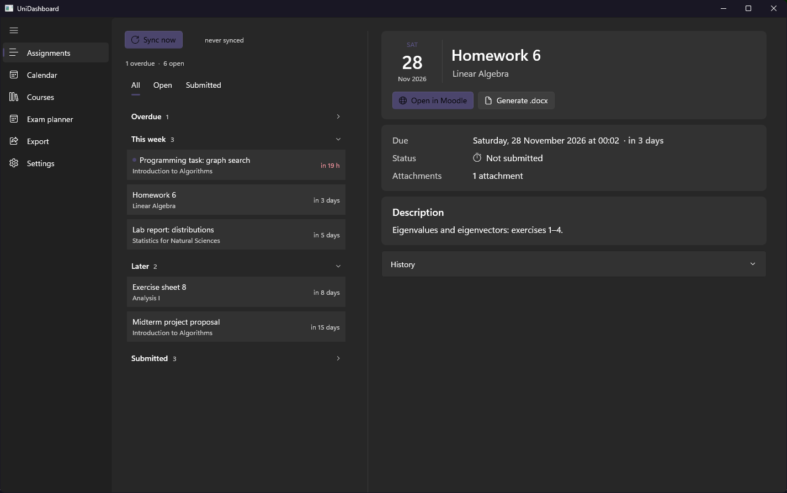
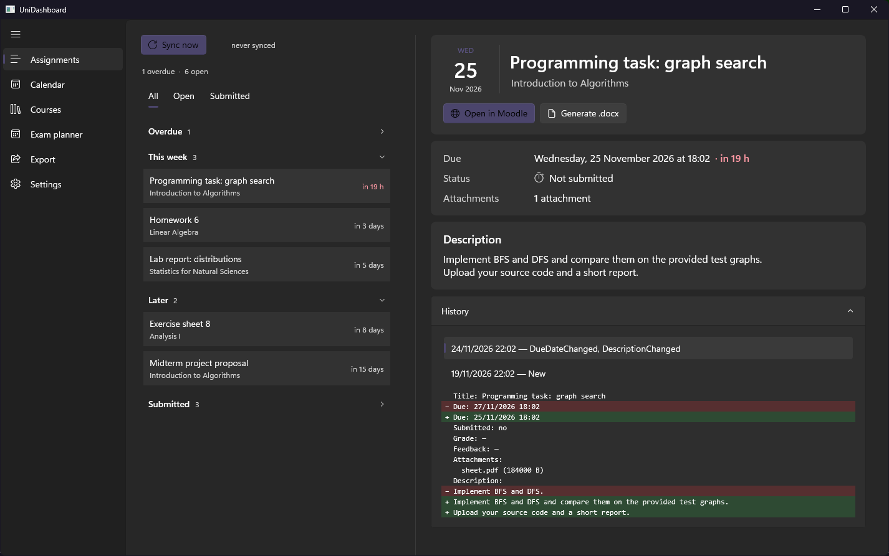
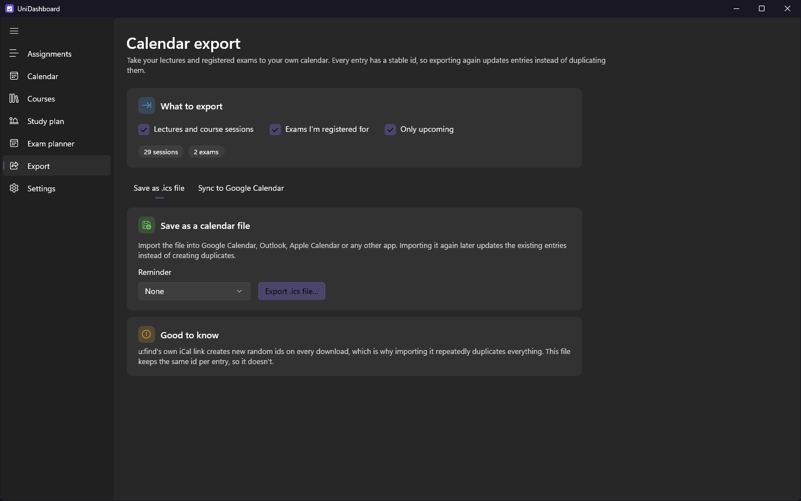
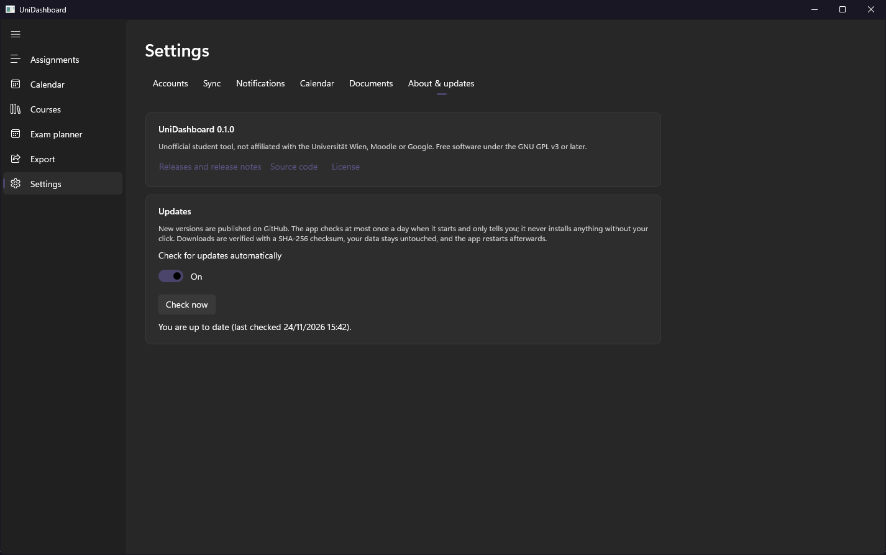

# Features

## Assignments

- **Grouped list**: Overdue (only if not submitted), Today, This week, Later, and Submitted. Overdue and Submitted start collapsed (Submitted is open on the *Submitted* tab). Filter by all / open / submitted with the tabs above the list; a one-line summary shows how many are overdue or due today.
- Each row shows the title, the course, a relative due time that turns red as the deadline approaches, and a dot when something changed since you last looked.
- **Detail pane**: absolute and relative due date, submission status, grade, the description, attachment count (files are downloaded in Moodle, not here), **Open in Moodle** and **Generate .docx**.
- Opening an assignment clears its "changed" dot.

### Change history

Every time the data of an assignment changes (new, due date, description, grade or feedback, attachments, submission status) the app stores a snapshot. Expand **History** to compare any snapshot with the one before it as a coloured line diff.

Toast notifications are sent for: new assignment, due date changed, description changed, grade or feedback. Attachment changes and submission status are recorded silently (the dot in the list). A **deadline reminder** fires once when an unsubmitted assignment is due within the configured number of hours (24 by default); it fires again if the deadline moves, and never after the deadline.

## Calendar

One calendar for everything: lecture sessions (u:space), exam dates and registration windows, and assignment deadlines. Switch between **Week** and **Month**; the *Exams* toggle hides exam entries.

- A session that was **moved** appears faded at its old time as well as at the new one; a **cancelled** session is struck through. Both are shown for about a week (switch off in *Settings → Calendar*).
- Click an entry for details, a link to the course, or the assignment.
- Overdue assignments are tinted red, submitted ones are ticked.

## Courses

Your u:space enrolments with type (VO, UE, VU…), semester, status (including waitlist position), lecturers, every session with its room, and all exam dates with their registration and deregistration windows. Your own registrations are ticked. A **History** section lists changes the app noticed (new course, status change, moved/cancelled sessions, changed exam dates).

## Exam planner

For each course with several exam dates the planner picks one, according to your choice:

- *As soon as possible*, *as late as possible*, or *as spaced out as possible* (with an optional ideal gap in days),
- never clashing with your lecture sessions or with another chosen exam,
- never suggesting a date whose registration has already closed.

You can pin a date, exclude a course, or restrict the range. Gaps between exams are colour-coded. **The planner is only a recommendation; nothing is registered for you.** Register for the dates in u:space yourself.

## Export

Takes your lectures and the exams you are registered for to a calendar app.

- **Save as `.ics`**: import into Google Calendar, Outlook, Apple Calendar... Every entry has a stable id, so importing a newer file *updates* entries instead of duplicating them (u:find's own iCal link generates new random ids each time, which is why it duplicates). Optional reminder before each event.
- **Sync to Google Calendar**: a one-way sync into a calendar you choose, with a preview before anything is written. See [Google Calendar setup](google-calendar-setup.md).

## Notifications and background agent

A hidden scheduled task runs `UniDashboard.Agent.exe` at logon and then every *N* minutes. It performs one sync pass (Moodle assignments, u:space/u:find courses, optionally Google Calendar), raises the toasts you enabled, and exits. Clicking a toast opens the app on the relevant assignment or course. Never more than one sync runs at a time, even if the app and the agent overlap.

Toast kinds include: new / changed assignments, deadline reminders, new enrolment, enrolment status change (waitlist, deregistered...), session moved / changed / cancelled / added, exam dates changed, exam registration opens or closes soon, and "login required".

## Word documents

**Generate .docx** on an assignment fills a Word template with the assignment data and asks where to save it. Set your name and Matrikelnummer under *Settings → Documents*. Without a template of your own a default one is created. Placeholders you can use in your own `.docx` / `.dotx` template:

`{{Title}}` `{{Course}}` `{{Author}}` `{{Matrikel}}` `{{Date}}` `{{DueDate}}` `{{MoodleUrl}}` `{{Description}}`

Nothing is cached: the file is generated on demand and saved only where you choose.

## Updates

**Settings → About & updates** shows the installed version and lets you check for a newer release. The app also checks once a day at startup (switchable) and shows a banner; installing always needs your click, verifies a SHA-256 checksum first and keeps all your data. See [releasing](releasing.md) for how updates are published.