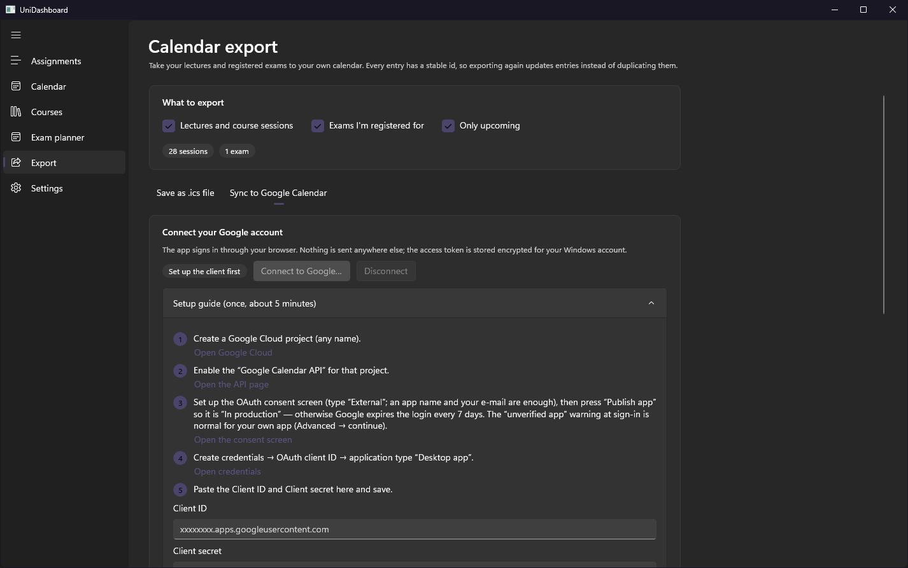

# Google Calendar sync

UniDashboard can keep a Google Calendar of your choice in sync with your lectures and the exams you are registered for. Because there is no shared "UniDashboard" Google app, you create a tiny OAuth client of your own once (about 5 minutes). The same guide is built into the app on **Export → Sync to Google Calendar**.

## One-time setup

1. Create a project in the [Google Cloud console](https://console.cloud.google.com/) (any name).
2. Enable the **Google Calendar API** for that project.
3. Configure the **OAuth consent screen**: user type *External*, an app name and your e-mail are enough. Then press **Publish app** so the status is *In production*. Otherwise Google expires the login every 7 days. The "unverified app" warning at sign-in is normal for your own app (*Advanced → continue*).
4. **Credentials → Create credentials → OAuth client ID**, application type **Desktop app**.
5. Paste the **Client ID** and **Client secret** into the app, press **Save client**, then press **Connect to Google…** and sign in in your browser.

The app requests two scopes only: `calendar.events` (create/update/delete events) and `calendar.calendarlist.readonly` (to let you pick a calendar). The client ID/secret and the refresh token are stored encrypted with DPAPI in `%LOCALAPPDATA%\UniDashboard\google.bin`.

## Using it

1. Pick the calendar under **Sync into this calendar**. Using a dedicated calendar (for example "Studium") is recommended.
2. Under *Look for events I imported myself…* optionally tick calendars that may hold older imports of your timetable (for example from u:find's iCal link). Matching events there are *not* duplicated, and you can choose to clean them up.
3. Press **Preview changes**. Nothing is written yet; you see what would be created, updated and deleted, and what is skipped and why.
4. Press **Apply changes** (or **Sync now** to do both in one go). Optionally tick *Sync automatically in the background* so the agent does this after every sync.

## Safety rules

The sync is designed so that it cannot damage a calendar you also use for other things. These rules are covered by unit tests (`SyncPlanner`, `GoogleSyncService`).

- **Only our own events are touched.** Every event the app creates carries hidden tags (`uni_dashboard_managed`, `uni_dashboard_key`, `uni_dashboard_hash`). Only events with the tag, or recorded in the app's sync state, are ever updated or deleted.
- **Your edits win.** If you change one of our events in Google, it is left alone (unless you enable *Overwrite events I edited in Google*).
- **Deleted by you means deleted.** An event you removed in Google is not silently recreated; it is listed under *Not recreated — you deleted them in Google*.
- **No duplicates.** Events keep a stable id; a session that moved to another day continues the same Google event. Events you already have from an old import are skipped.
- **Nothing is deleted when the data source looks broken** (a failed or empty sync).
- **Mass-delete guard.** If a run would delete unusually many events, it stops and asks for explicit confirmation.
- **Each deletion is re-checked** right before it happens (the event must still carry our tag and be unchanged).

## Undo

*Remove everything this app created in this calendar…* deletes exactly the events carrying the app's tag, after a confirmation. Your own events and old imports are not touched. Google keeps deleted events in the trash for about 30 days. If you sync again afterwards, the removed events are restored.

## Troubleshooting

| Message / symptom | Meaning |
|---|---|
| "Set up the client first" | Client ID/secret not saved yet (step 5). |
| Login asks again after a week | The consent screen is still in *Testing*; publish it (step 3). |
| "…is read-only for you" | Choose a calendar you can edit. |
| Events missing after switching calendars | Sync state is per calendar; events in the previously used calendar stay there untouched. |
